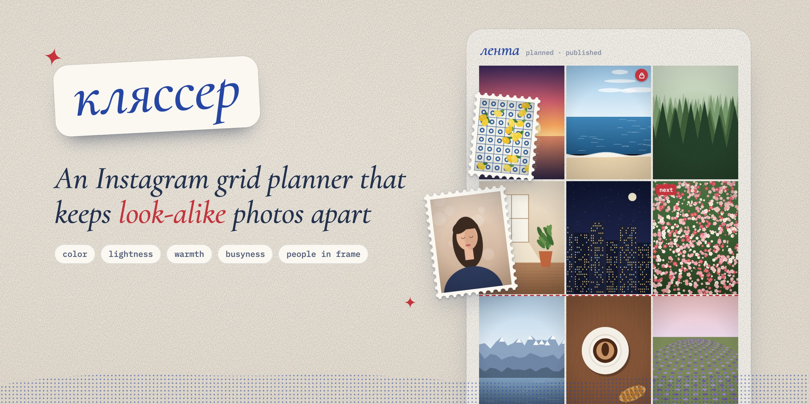
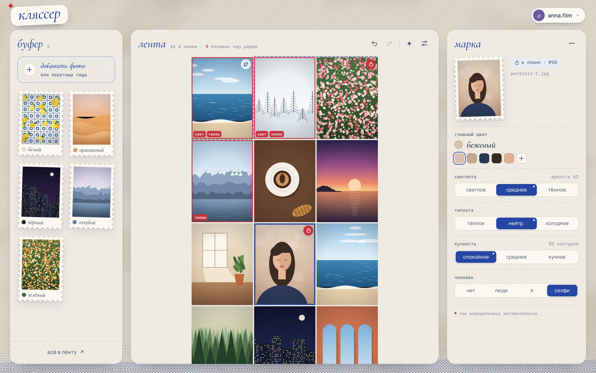
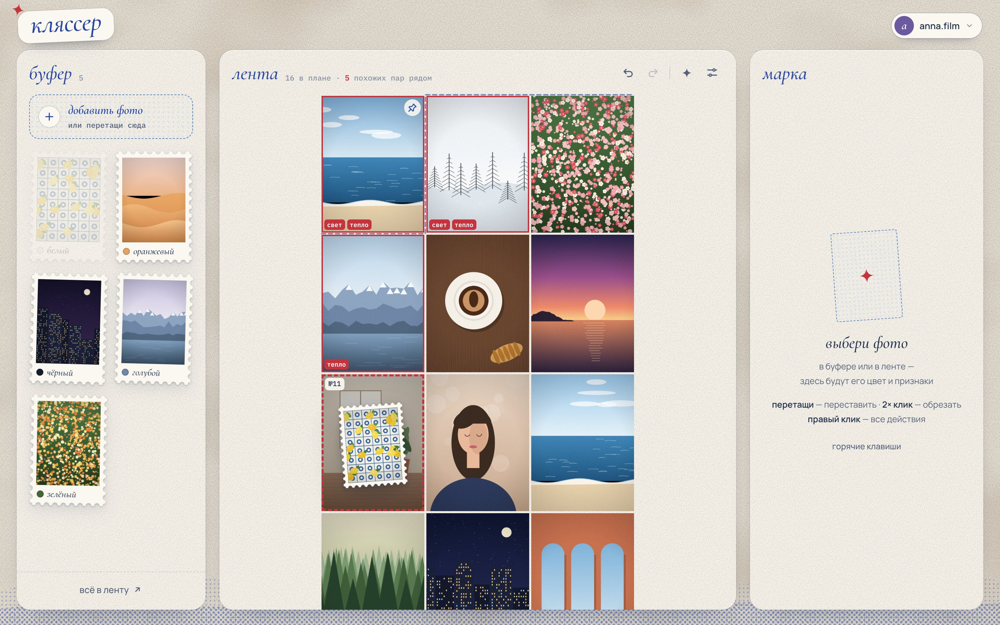
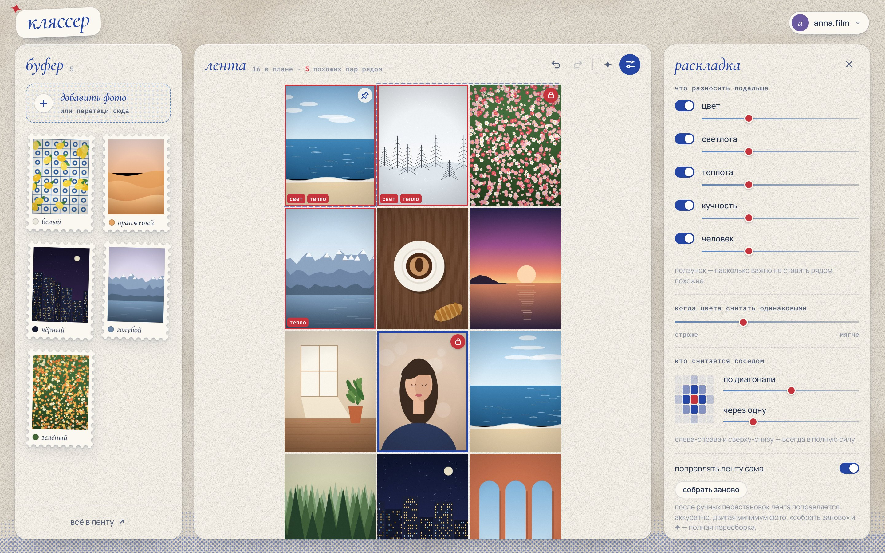
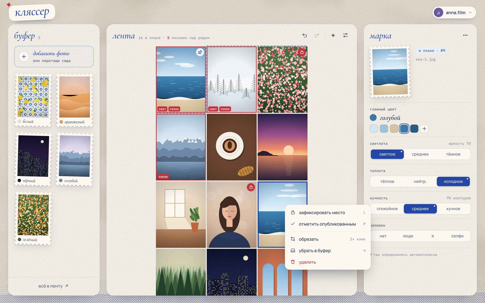
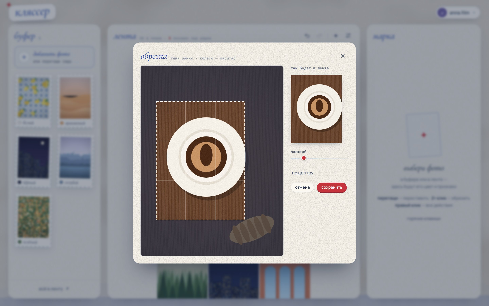
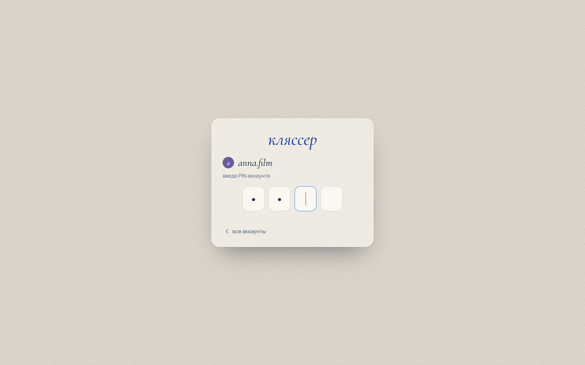

<p align="center">
  
</p>

<p align="center">
  <b>Klyasser</b> plans your upcoming Instagram posts so that photos with the same color, lightness,
  warmth, level of detail or person in frame never end up side by side.
  <br>
  <sub><i>кляссер</i> — the album stamp collectors use to lay out their stamps.</sub>
</p>

<p align="center">
  <a href="#features">Features</a> ·
  <a href="#screenshots">Screenshots</a> ·
  <a href="#how-it-works">How it works</a> ·
  <a href="#getting-started">Getting started</a> ·
  <a href="README.ru.md">По-русски</a>
</p>

<p align="center">
  
</p>

> The interface is in Russian — the app was built for a Russian-speaking photographer.
> Everything else (code, deployment, this README) is language-neutral.

## Why

A good-looking Instagram profile has rhythm: a calm photo next to a busy one, warm next to cool,
never two selfies in a row. Keeping that rhythm by hand for ten posts a week is tedious, and it falls
apart every time you add a photo or change your mind.

Klyasser looks at every photo you upload, then lays out the plan so that neighbours differ —
while letting you pin any photo exactly where you want it.

## Features

- **Automatic photo analysis, right in the browser** — dominant color (k-means in CIELAB),
  lightness, warm/cool balance and busyness (edge density). Every value can be overridden in one click.
- **People in frame** — tag photos as *no people / people / me / selfie* with keys `1`–`4`.
  A selfie next to another photo of you counts as a near-clash.
- **Smart layout** — an optimizer minimizes how similar neighbouring posts are. Side-by-side and
  vertical neighbours count fully; diagonals and "two cells away" count with adjustable weights.
- **Stable while you post** — neighbours are measured by distance in the posting queue, so the layout
  still holds after every new post shifts the grid by one cell.
- **Gentle re-layout** — after a manual move only a few photos move, and only if it clearly helps.
  `✦` gives you a completely different arrangement by the same rules.
- **Lock any cell** — pin a photo to its spot and everything else flows around it. Published posts
  are frozen; up to three profile-pinned posts are supported, just like Instagram.
- **Buffer** — drop in a batch of photos, keep some waiting, drag the rest into the grid and back.
- **Undo / redo everything**, a toast to restore deleted photos, keyboard shortcuts.
- **3:4 crop** — choose what part of the photo shows in the grid; the analysis follows the crop.
- **HEIC support** — iPhone photos are converted to JPEG in the browser when needed.
- **Light storage** — photos are downscaled to 1440 px (the height of a 3:4 Instagram post) and re-encoded,
  so a 5–20 MB original takes ~100–250 KB. Originals are never stored; EXIF and location are stripped.
- **Upload queue with progress** — add more photos while the previous ones are still uploading.
- **Several accounts, no sign-up** — each Instagram account has its own photos, layout and set of
  features, protected by a 4-digit PIN. New accounts can require an invite code.
- **Safe on two computers at once** — versioned saves never overwrite a newer layout.

## Screenshots

<table>
  <tr>
    <td width="50%" valign="top">
      
      <br><sub><b>Drag & drop.</b> Drop a photo on a cell to pin it there, or anywhere in the grid to let Klyasser find a spot.</sub>
    </td>
    <td width="50%" valign="top">
      
      <br><sub><b>Layout settings.</b> Turn features on or off per account, set how much each one matters and who counts as a neighbour.</sub>
    </td>
  </tr>
  <tr>
    <td width="50%" valign="top">
      
      <br><sub><b>Right-click actions.</b> Lock a spot, mark as posted, crop, move back to the buffer, delete.</sub>
    </td>
    <td width="50%" valign="top">
      
      <br><sub><b>3:4 crop.</b> Pick the part of the photo that shows in the grid.</sub>
    </td>
  </tr>
  <tr>
    <td width="50%" valign="top">
      
      <br><sub><b>PIN sign-in.</b> No passwords or e-mails — every account has its own PIN.</sub>
    </td>
    <td width="50%" valign="top">
      <sub>The photos in these screenshots are drawn by <a href="docs/tools/scenes.js"><code>docs/tools/scenes.js</code></a>;
      the screenshots themselves are taken by <a href="docs/tools/shoot.mjs"><code>docs/tools/shoot.mjs</code></a> in headless Chrome.</sub>
    </td>
  </tr>
</table>

## How it works

1. **Analysis.** When a photo is added, the browser scales it to 1600 px, cuts the 3:4 frame that will
   show in the grid and measures it:
   - *color* — k-means (k = 5) in CIELAB; the dominant cluster is weighted towards saturated colors;
   - *lightness* — mean L\*: light / medium / dark;
   - *warmth* — mean b\* + 0.35 · a\*: warm / neutral / cool;
   - *busyness* — share of strong Sobel edges: calm / medium / busy.
2. **Similarity.** For two photos, every enabled feature gives a score from 0 to 1 — for color it is
   `1 − ΔE / tolerance`, for the other features "both are extreme in the same way" scores high and
   "both are average" scores low — and the scores are summed with your weights.
3. **Cost.** The grid is read as the posting queue. Pairs at distance 1 and 3 (left/right, above/below)
   count fully, 2 and 4 (diagonals) and 5–6 (two cells away) count with their weights.
4. **Optimization.** Locked, published and pinned cells stay put; the free photos are permuted.
   A full layout is a seeded shuffle plus simulated annealing plus a greedy polish (≈30 ms for 40 photos);
   a gentle re-layout applies at most a dozen of the most useful swaps.

The server only stores things: accounts, layouts and image files. All the heavy lifting happens in the browser.

## Getting started

### Run locally or on your own server

Requires Node.js 22.13+ (it uses the built-in SQLite). No `npm install`.

```bash
node server.js
```

Open http://localhost:4173 and create the first account.

| variable | purpose |
|---|---|
| `PORT` | port, `4173` by default |
| `HOST` | `0.0.0.0` to accept connections from other machines; localhost only by default |
| `KLYASSER_DATA` | where the database and photos live, `./data` by default |
| `KLYASSER_INVITE` | invite code required to create an account — set it if the server is public |
| `KLYASSER_SECRET` | key for signing sign-in cookies; generated into `data/secret.key` if not set |

### Deploy to Cloudflare (free tier)

The same API runs on Cloudflare Workers with D1 for data and R2 for photos.
For a personal account this fits comfortably in the free tier (R2 asks for a payment card on file).

```bash
cd cloudflare
npm install
npx wrangler login
npx wrangler d1 create klyasser          # put the database_id into wrangler.jsonc
npx wrangler r2 bucket create klyasser-photos
npm run db:migrate:remote
npx wrangler secret put KLYASSER_SECRET  # any long random string
npx wrangler secret put KLYASSER_INVITE  # optional invite code
npm run deploy
```

Replace the `routes` block in [`cloudflare/wrangler.jsonc`](cloudflare/wrangler.jsonc) with your own domain or remove it
to use `*.workers.dev`. A storage mode without R2 (photos in D1), limits and details are described in
[`cloudflare/README.md`](cloudflare/README.md) (in Russian).

## Project structure

```
public/index.html   the whole UI: analysis, layout, crop, PIN sign-in — vanilla JS, no build step
server.js           zero-dependency Node server: accounts, PINs, layouts, photos (SQLite + files)
cloudflare/         the same API on Cloudflare Workers + D1 + R2
docs/tools/         screenshot script (headless Chrome) and the demo scene generator
```

## Privacy and security

- Photos and layouts are stored only on your server or in your Cloudflare account; analysis runs locally in the browser.
- PINs are hashed (scrypt on Node, PBKDF2 on Workers). Sign-in uses a signed `HttpOnly` cookie,
  and every 5 wrong PINs lock the account for 1, 2, 4… up to 32 minutes.
- Third-party requests: Google Fonts, and the HEIC converter from jsDelivr (pinned version with SRI),
  which is loaded only when a HEIC photo is added in a browser that can't open it natively.

## Updating the screenshots

```bash
node docs/tools/shoot.mjs
```

Needs Google Chrome; set `CHROME=/path/to/chrome` if it isn't in the default location. The script starts
`server.js` with a throwaway database, fills a demo account and writes `docs/screenshots/*.jpg` and `docs/banner.jpg`.
