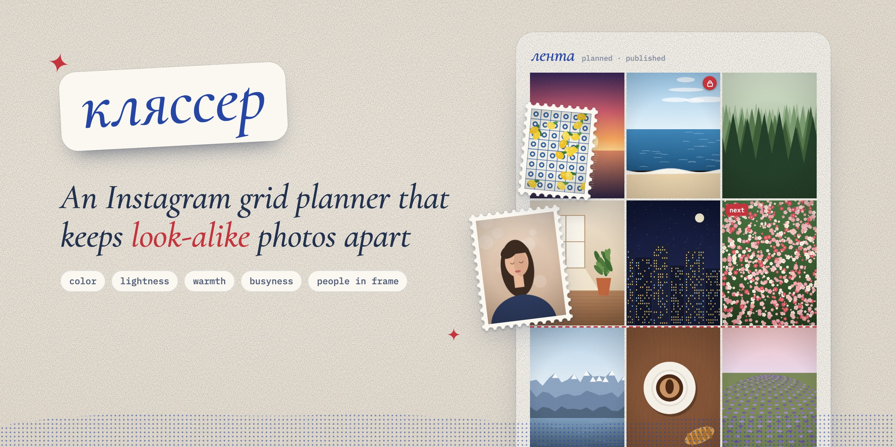
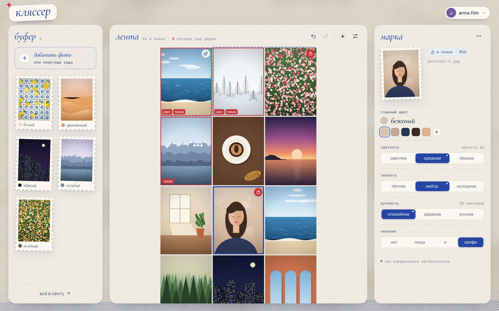

<p align="center">
  
</p>

# Кляссер

Раскладка ленты Instagram: фото с похожими признаками (цвет, светлота, теплота, кучность, человек в кадре)
разносятся подальше друг от друга. [English version](README.md)



## Что умеет

- Сам определяет главный цвет, светлоту, теплоту и кучность каждого фото — прямо в браузере. Любое значение можно поправить.
- Человек в кадре размечается вручную: нет людей / люди / я / селфи (клавиши 1–4).
- Раскладывает план так, чтобы соседи отличались. Соседство считается по очереди публикации, поэтому раскладка не ломается, когда после каждого поста лента сдвигается на клетку.
- Любую клетку можно зафиксировать — остальные фото подстраиваются вокруг. Опубликованное заморожено, до трёх постов можно закрепить в профиле.
- Буфер для новых фото, перетаскивание в ленту и обратно, отмена и возврат, обрезка 3:4, поддержка HEIC.
- Несколько аккаунтов без регистрации: у каждого свои фото, раскладка и набор признаков, вход по PIN. Для новых аккаунтов можно требовать код приглашения.

## Запуск

Нужен Node 22.13+, `npm install` не нужен.

```bash
node server.js
```

Открыть http://localhost:4173

| переменная | зачем |
|---|---|
| `PORT` | порт, по умолчанию 4173 |
| `HOST` | `0.0.0.0` — открыть для локальной сети или сервера; по умолчанию только этот компьютер |
| `KLYASSER_DATA` | папка с базой и фото, по умолчанию `./data` |
| `KLYASSER_INVITE` | код, без которого нельзя создать новый аккаунт. Включи, если сервер доступен из интернета |
| `KLYASSER_SECRET` | ключ для подписи входа; если не задан, создаётся в `data/secret.key` |

Выкладка на Cloudflare (бесплатно) — в [cloudflare/README.md](cloudflare/README.md).

## Что где

- `public/index.html` — весь интерфейс: анализ фото, раскладка, обрезка, вход по PIN
- `server.js` — сервер для своего компьютера или VPS: аккаунты, PIN, хранение (SQLite + файлы)
- `data/` — база `klyasser.db` и фото для `server.js`. Бэкап — скопировать эту папку
- `cloudflare/` — тот же сервер для Cloudflare Workers + D1 + R2
- `docs/tools/` — скрипт скриншотов (`node docs/tools/shoot.mjs`) и генератор демо-снимков

## Как устроено

- У каждого аккаунта своя лента, буфер, фото и настройки. Список аккаунтов виден всем, открыть аккаунт можно только по его PIN. После 5 неверных попыток аккаунт закрывается на время.
- Признаки общие, в каждом аккаунте их можно включать и выключать.
- Если аккаунт поменяли на двух компьютерах одновременно, сервер не даст перезаписать свежую версию: вкладка с устаревшими данными подтянет актуальные.
- Тяжёлое (анализ фото, подбор раскладки) считается в браузере, сервер только хранит.
